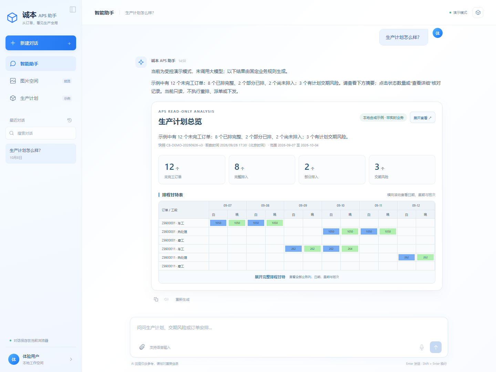
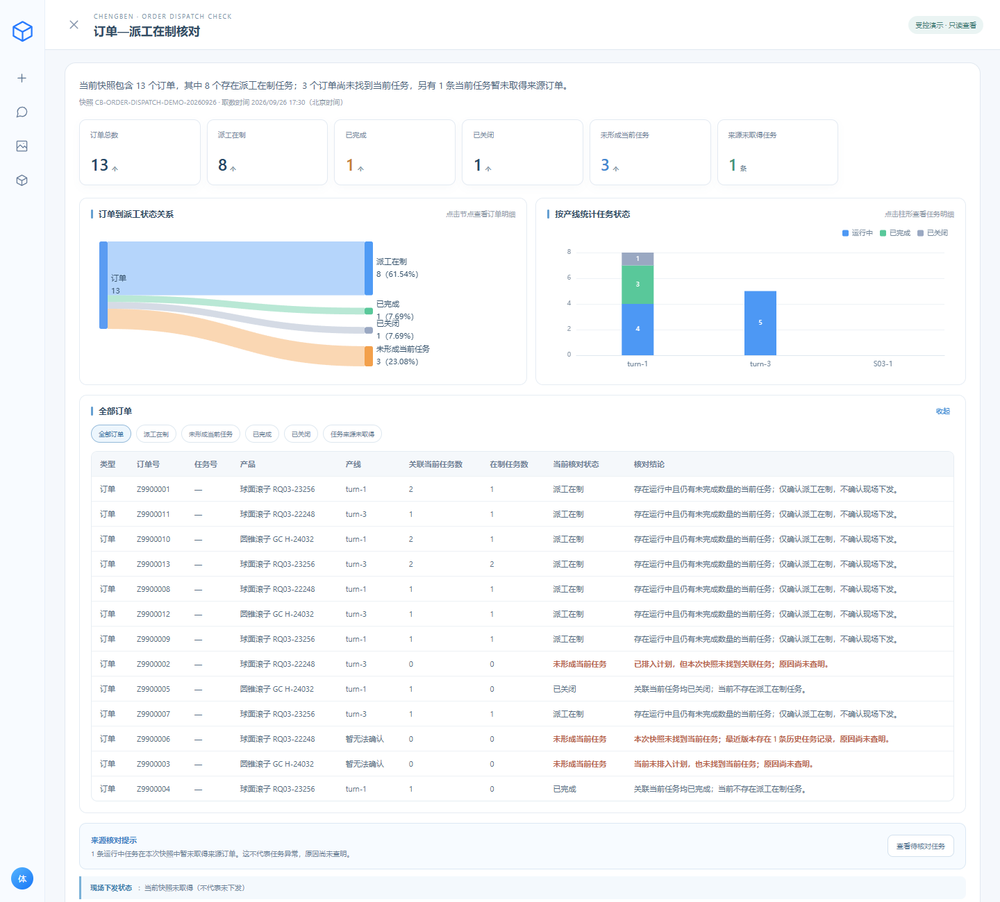

# 诚本 APS 生产计划排程助手

面向制造业计划人员的对话式 APS 产品原型，围绕生产计划串联交期风险、物料核对、派工查询与计划调整，让用户从自然语言提问进入可追溯的业务明细。

## 业务背景

计划人员核对一张订单时，往往需要连续查看排程、物料和派工记录。这些信息的来源与含义各不相同：排入计划不代表生产完成，存在派工记录也不能直接说明已经下发现场。助手既要降低查询门槛，也要准确表达业务状态与判断依据。

项目将“提问—理解结论—核对明细—确认操作”组织为连续体验，在复用现有排程能力的同时，保留业务规则和人工判断的位置。

## 我的工作

- **校准业务含义与操作边界**：分别核对订单、排程、物料和派工的来源，明确“排入计划”“生产完成”“派工在制”“模拟下发”的含义，以及独立 MRP 与主计划之间的关系。
- **设计模型与工具协议**：将用户问题映射为业务工具及受限参数；模型接收事实摘要，完整图表与明细直接传给前端，避免让模型重新生成业务数据。
- **定义计划调整的确认链路**：以当前整批需求为基准，设计准备输入、确认试排、核对影响、采用和撤销；保存已展示的计算引用，区分当前方案与历史快照。
- **推动状态与事实一致性迭代**：将已采用计划从聊天记录中独立出来，明确旧结果、并发、取消与失败时的处理规则；借助 AI 辅助编码落地，并用受控回归核对行为。

## 核心体验

### 用业务语言查计划，按需展开依据

用户可以询问生产计划、订单安排和交期风险。助手先给出简短结论与关键指标，再通过订单表和矩阵式甘特表展示日期、工序、班次及产线，支持从整体判断进入具体记录核对。



### 围绕同一订单核对物料与派工

从排程查询继续核对物料和派工，保持订单上下文一致。派工详情将订单、任务与产线分别呈现，并支持按产线和状态筛选，帮助用户追溯结论对应的业务记录。



### 调整当前计划，保留采用与撤销的选择

以当前整批需求为基准，支持批次外订单加入、顺序调整、整批试排、结果核对及采用或撤销。已采用计划在同一浏览器、同一站点内跨对话共享，历史消息保留当时结果。

独立 MRP 展示需求分解、库存与在途抵扣及剩余需求；保存核算结果不会自动改变主计划，计划调整后也不会沿用旧版本结论。

### 在不同规模下保持查询与当前计划一致

提供 `small13` 和 `large85` 两套脱敏示例。公开版默认使用小集；大集以 84 单为基线，另保留 1 个待加入计划的订单，用于核对批量查询、明细筛选和计划状态承接。数据集在启动和构建时选定，页面与服务同时核验数据集、需求版本、样例标识及输入指纹；不一致时提示刷新，保留当前计划。

聊天记录增加主备恢复、删除标记与保存失败提示。取消、删除或切换对话后的迟到结果，在提交前校验操作归属，避免覆盖当前计划或复活已删除的会话。

## 关键迭代：让业务计划独立于聊天记录

| 环节 | 具体判断 |
|---|---|
| 发现的问题 | 新订单加入并采用 13 单方案后，新建对话仍可能初始化为 12 单，后续查询和调序失去已经采用的新订单 |
| 判断依据 | 原业务状态附着在单个对话中；新对话初始化和旧卡片恢复都可能覆盖当前计划，问题涉及状态归属与版本承接 |
| 我的选择 | 将已采用计划、独立 MRP 引用和下发状态存为工作区业务状态，聊天只保存消息、未采用试排与界面状态；采用、撤销和保存都校验完整基准与版本 |
| 验证结果 | 受控回归覆盖采用 13 单后新建、切换及重新载入工作区继续调序；旧结果与并发提交不能覆盖新计划，撤销调序保留之前加入的新订单 |

模型与展示数据的分工见[工具返回协议](agent-backend/Tools/Results/ToolResult.cs#L19)；状态承接与撤销规则见[共享计划用例](tests/frontend/shared-plan.test.mjs#L14)。共享范围为同一浏览器、同一站点，未扩展为跨设备同步。

## 验证与评价

已有验证分开检查业务状态与回答事实，避免用界面展示成功代替完整能力验证：

| 评价问题 | 已有结果与证据 |
|---|---|
| 当前计划能否持续承接 | 12 单基线插入并采用后为 13 单；新建或切换对话后继续调整仍保留 13 单，撤销恢复本次采用前态。见[共享计划用例](tests/frontend/shared-plan.test.mjs#L14) |
| 旧结果、并发及失败是否改变已提交方案 | 同一基准的并发提交只允许一个成功；旧卡片、取消和存储失败不能覆盖当前计划。见[版本与失败用例](tests/frontend/shared-plan.test.mjs#L23) |
| 回复事实是否与工具结果一致 | 已建立风险数、物料数量与当前工作区范围的离线回归；摘要事实与完整展示数据分开传递。见[事实与范围用例](tests/unit/PrototypeRegressionTests.cs#L12) |
| 页面与服务是否使用同一份输入 | 同时核验数据集及版本等四项身份字段，缺失或不一致时停止相关操作。见[数据集一致性用例](tests/frontend/dataset-runtime-guard.test.mjs) |
| 保存失败或切换会话后能否恢复 | 主备记录恢复、删除标记、跨窗口冲突和迟到提交分别验证。见[聊天存储恢复用例](tests/frontend/chat-storage-recovery.test.mjs)与[操作生命周期用例](tests/frontend/non-model-lifecycle.test.mjs) |

后续计划在同一数据与计划版本的固定问题集上，分别统计真实模型的工具选择正确率、参数正确率、回答事实一致率及失败恢复情况。现有状态回归与构造回复校验不作为这些模型指标的统计结果。

已形成查询、计划调整与独立 MRP 原型，支持模型工具调用和结构化结果展示。公开版本使用脱敏样例；动态计算依赖独立准备的隔离排程环境，当前未接入正式 MES 写回。

## 技术与运行

前端采用 Vue 3、Pinia、Vite 与 ECharts；后端采用 ASP.NET Core 6 和 Semantic Kernel，通过 SSE 返回回答及结构化展示数据。

<details>
<summary>运行环境、模型配置与常用命令</summary>

需要 Docker 与 Docker Compose。在仓库根目录准备本地配置并启动服务：

```bash
cp .env.example .env
docker compose --env-file .env up -d --build --wait
```

打开 <http://127.0.0.1:19440/>。默认 `AGENT_MODE=demo` 无需模型密钥；使用工具调用模式时，设置 `AGENT_MODE=model`，并填写 `SK_ENDPOINT`、`SK_API_KEY` 和 `SK_MODEL_ID`。语音服务按需单独配置。

`.env` 中的 `APS_DEMO_DATASET` 支持 `small13`（默认）和 `large85`。更改后重新执行上述构建启动命令，让前后端使用同一数据集；无需上传或运行本机启动脚本。现有截图展示小集交互。

动态插入、重排、MRP 和模拟下发需要匹配的隔离 SQL 副本及 `dev-config/native-demo/worker.py`。数据库与原业务凭据不在仓库中；worker 使用无网络、无宿主端口的 SQL 容器，演示库名为 `ApsIsolatedDemo`，原过程执行后回滚。运行目录通过 `NATIVE_DEMO_RUNTIME_PATH` 挂载，默认是 `./runtime/native-demo`。

使用大集进行动态计算时，运行目录也须指向对应的数据集环境；不匹配或未准备环境时保留当前计划并返回明确提示。仅查询随仓库提供的静态示例不需要原业务数据库。

```bash
pnpm --dir web-frontend install --frozen-lockfile
pnpm --dir web-frontend build
node --test tests/frontend/*.test.mjs
dotnet test tests/unit/WePilot.Tests.csproj -c Release
python -m unittest discover -s tests/native_demo
```

前端需要 Node.js 20.19 及以上版本，后端测试需要 .NET 6 SDK。`tests/agent-evals/` 保留模型评测脚本，运行前需自行配置并确认模型调用及数据外发范围。

</details>
